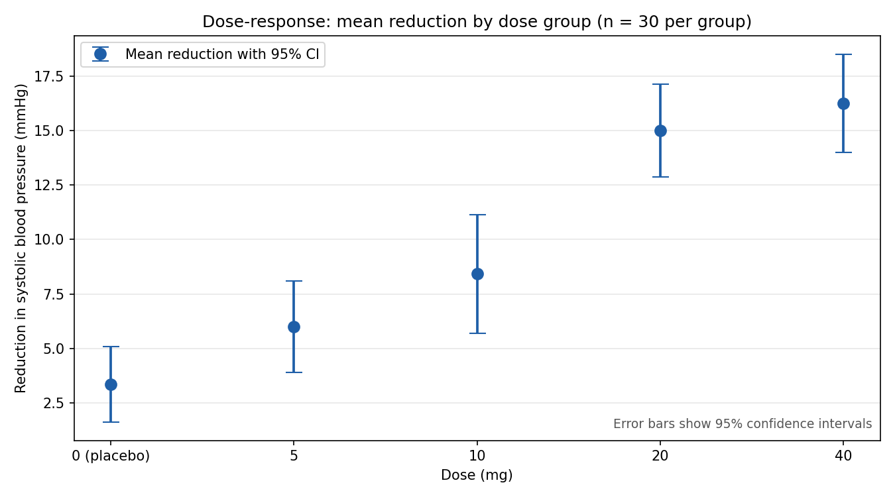

# Chart-Reasoning-Suite — Domain-Specific Question Sets for Chart Reasoning

[](https://github.com/yazanus94-dot/Chart-Reasoning-Suite_Projects/actions/workflows/ci.yml)


## Overview

This repository provides three curated sets of chart-based questions for evaluating
and stress-testing chart reasoning across distinct domains: **Biomedical**,
**Load Testing**, and **SPC / Quality**.

Each set is a self-contained project: a CLP generator draws seeded synthetic
charts, computes ground-truth answers in code, runs it through an ambiguity
check, and emits machine-readable question/answer files. The suite is intended
for researchers, developers, and educators benchmarking or fine-tuning models
on domain-specific chart interpretation tasks.

## Repository Contents

| Domain | Package | Contents |
|--------|---------|----------|
| **Biomedical** | `biocharts` | Dose–response curves with 95 % CIs, heart-rate time series, dose-vs-reduction scatter. |
| **Load Testing** | `loadcharts` | Throughput vs response time, response-time percentiles, error rate vs concurrent users. |
| **SPC / Quality** | `spccharts` | Shewhart control charts, Pareto charts of defect causes, process-capability histograms. |
| `archive/` | — | Original ZIP archives, kept for provenance. |

## Example



> **bio-q01** — *Chart: `fig1_dose_response_error_bars.png`*
>
> **Q:** What is the difference in mean systolic blood-pressure reduction
> between the 20 mg group and the placebo (0 mg) group? Give the answer in
> mmHg to one decimal place.
>
> **A:** `11.6` *mmHg* — 1. Read the mean reduction for 20 mg (15.0 mmHg) and
> placebo (3.36 mmHg). 2. Difference = 15.0 − 3.36 = **11.6**.
>
> *Reading-error robustness: 100 %*

Every generated question carries a code-verified answer, a step-by-step
solution, and an ambiguity check. See the full sets:
[`biomedical`](biomedical/biomedical-chart-questions/output/questions.md) ·
[`loadtest`](loadtest/loadtest-chart-questions/output/questions.md) ·
[`spc-quality`](spc-quality/spc-quality-chart-questions/output/questions.md).

## How to Use

```bash
git clone https://github.com/yazanus94-dot/Chart-Reasoning-Suite_Projects.git
cd Chart-Reasoning-Suite_Projects
```

Each domain set is a self-contained project. Enter the domain folder you need,
install its requirements, and run its CLI to (re)generate the chart images and
the question/answer files:

```bash
python -m biocharts.cli     # biomedical — draws images/, writes output/questions.md + output/answers.json
python -m loadcharts.cli    # load testing
python -m spccharts.cli     # SPC / quality

python -m pytest -q         # 37 tests across the three domains
```

Run tests per domain from inside the respective package directory, e.g.
`cd biomedical/biomedical-chart-questions && python -m pytest -q`.

## Question Format

For each domain, the generated material lives in `output/`:

- `output/questions.md` — the chart-reading questions together with computed
  answers, step-by-step solutions, and an ambiguity check.
- `output/answers.json` — the machine-readable answer key.
- `images/` — the chart images the questions refer to.

All data is **synthetic (seeded)** — no real patient, employer, or client data
is used. Questions and answers are generated and verified by code.

## License

MIT — one `LICENSE` at the repository root; each domain set also ships its own
copy.
