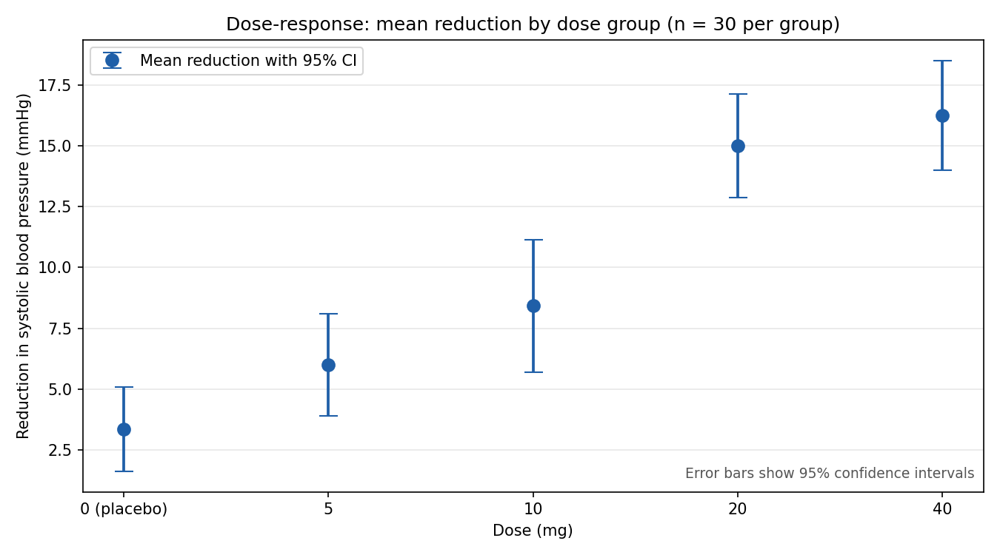
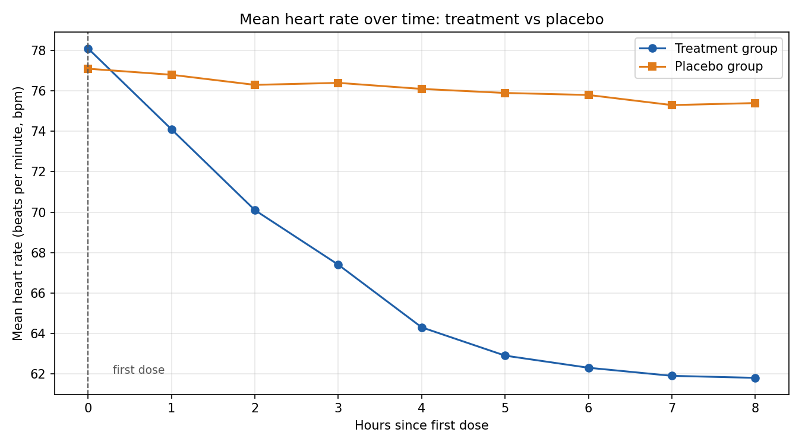
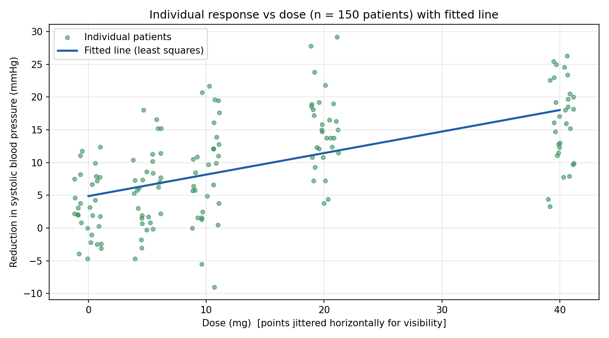

# biomedical-chart-questions

Run one command and get **real chart images** plus **chart-reading questions with computed answers, step-by-step
solutions and an ambiguity check**. The domain is medicine and biostatistics: error bars, time series and regression.

> **Portfolio project by Yazan Aljabari.** All data is synthetic (seeded) and is **not clinical data**.
> Questions and answers are generated and verified by code. No employer or client data is used.

```bash
pip install -r requirements.txt
python -m biocharts.cli           # draws images/, writes output/questions.md and output/answers.json
python -m pytest -q               # 13 tests
```

## The charts it draws




## What the questions test
Differences between group means, **non-overlapping 95% confidence intervals** (a statistical feature on the chart),
percentage change between two time points, a threshold crossing between two series, and the **slope of a fitted line**.
The full answer key with working is in [`output/questions.md`](output/questions.md).

## Design decisions
- **Statistics are derived from patient-level data** (mean, SD, 95% CI = 1.96 x SD / sqrt(n)), so the chart, the table and the answers cannot disagree.
- **Error-bar type is always stated.** A question that mentions error bars without saying whether they show SD, SEM or a 95% CI is flagged as ambiguous.
- **Ambiguity check.** Each answer is recomputed 300 times after nudging plotted values by +/-0.5%. During development, a
  "percentage fall to one decimal place" question failed this check, since two nearby readings cannot support that precision,
  so it was reworded to ask for the nearest whole percent. Two deliberately flawed demo questions stay flagged.
- **Independent verification in tests:** group statistics are recomputed with Python's `statistics`, and the regression slope is checked against `numpy.polyfit`.

## Limitations
Data follows simple generating formulas, so real trial data will be messier. The check simulates small reading errors, not misreading the chart type or axis.
