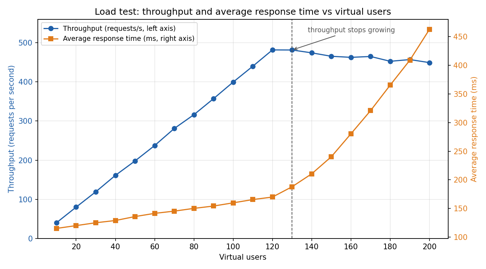
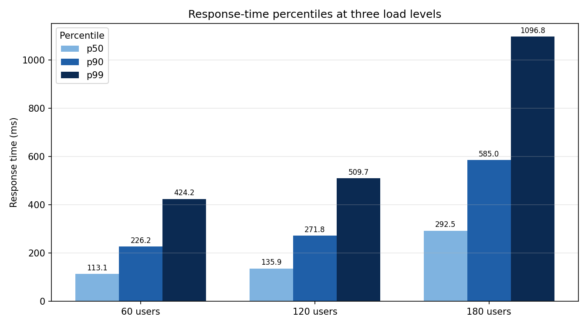
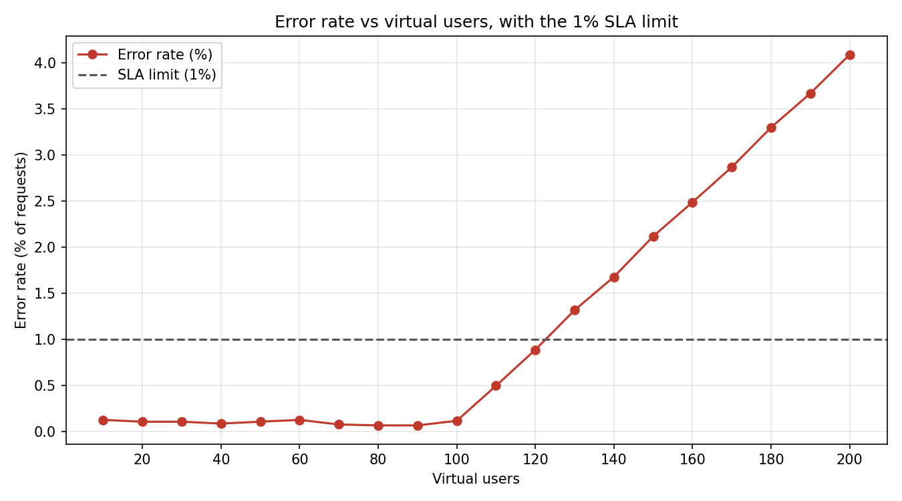

# loadtest-chart-questions

Run one command and get **real chart images** plus **chart-reading questions with computed answers, step-by-step
solutions, and an ambiguity check**. The domain is software performance engineering (load-test results).

> **Portfolio project by Yazan Aljabari.** All data is synthetic (seeded). The questions and answers are generated and
> verified by code. No employer or client data is used.

```bash
pip install -r requirements.txt
python -m loadcharts.cli          # draws images/, writes output/questions.md and output/answers.json
python -m pytest -q               # 12 tests
```

## The charts it draws




## What the questions test
Five questions require real reasoning, not just reading one value: finding where a trend flattens, computing a
percentage change between two points on a second axis, applying a threshold line, comparing percentile bars as a ratio,
and combining two charts. See [`output/questions.md`](output/questions.md) for the full answer key with working.

## Design decisions
- **Answers are computed, never typed.** Each question is a function of the data, so the key cannot drift from the chart.
- **Unambiguous wording.** Every question states its unit; the tests fail if a question forgets to.
- **Ambiguity check.** Each answer is recomputed 300 times after nudging plotted values by +/-0.5% (a reader's misjudgement).
  If the answer changes, the question is flagged and should not be submitted. The included demo question
  ("at how many users is throughput highest?") is correctly flagged because throughput is flat after about 120 users.
- **Reproducible.** Seeded data; the tests recompute answers with independent code.

## Limitations
The data follows simple formulas plus noise, so it is cleaner than real load-test output. The robustness check only
simulates small reading errors, not misreading the chart type or axis.
