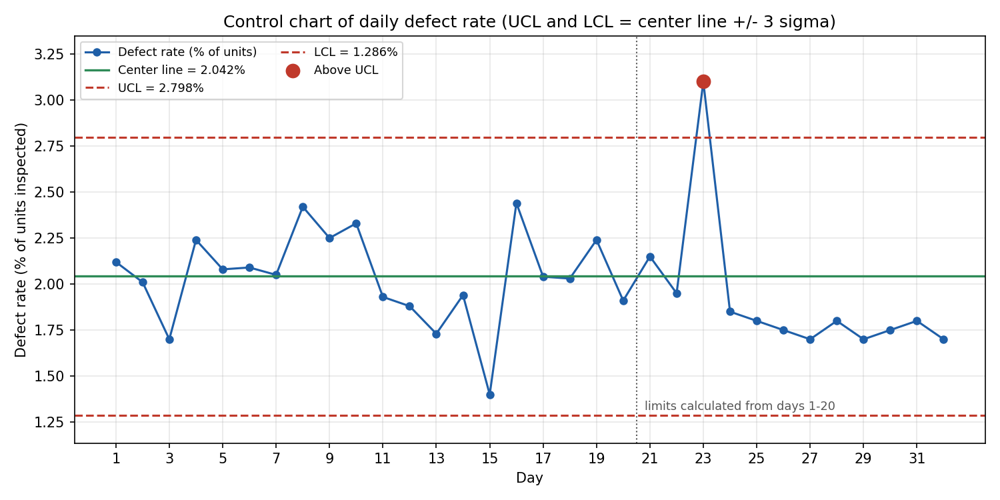
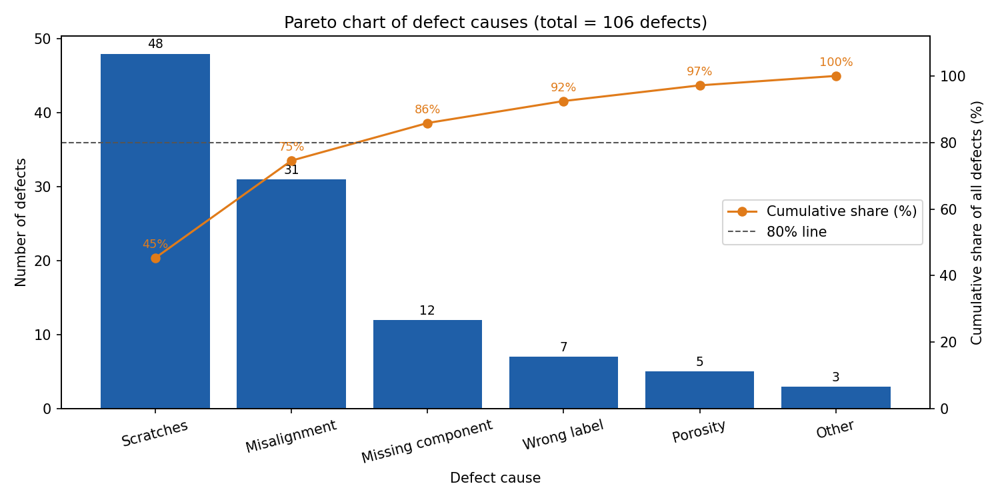
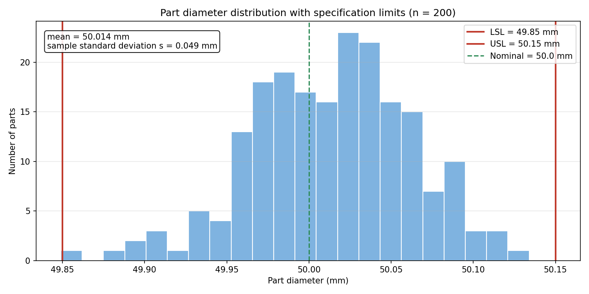

# spc-quality-chart-questions

Run one command and get **real chart images** plus **chart-reading questions with computed answers, step-by-step
solutions and an ambiguity check**. The domain is manufacturing quality: control charts, Pareto analysis and process capability.

> **Portfolio project by Yazan Aljabari.** All data is synthetic (seeded). Questions and answers are generated and
> verified by code. No employer or client data is used.

```bash
pip install -r requirements.txt
python -m spccharts.cli           # draws images/, writes output/questions.md and output/answers.json
python -m pytest -q               # 12 tests
```

## The charts it draws




## What the questions test
Counting points beyond control limits (UCL = center line + 3 sigma, calculated from the first 20 days), detecting a
**run of 8 consecutive points below the center line**, reading a **cumulative Pareto line** against an 80% threshold,
computing a share of defects, and a **multi-step process capability index (Cpk)** from the mean, sample standard
deviation and specification limits. See [`output/questions.md`](output/questions.md) for the answer key with working.

## Design decisions
- **Limits come from the data.** Center line, sigma, UCL and LCL are calculated from the baseline days, and tests re-derive them independently.
- **Unambiguous statistics.** Any question that uses a standard deviation must say whether it is the sample or population value; otherwise the check flags it.
- **Per-quantity reading error.** The ambiguity check nudges each plotted quantity by a plausible reading error (about 0.5% of its axis, or display rounding),
  recomputes each answer 300 times, and flags answers that change. Two deliberately flawed demo questions stay flagged.
- **Independent verification in tests:** answers are recomputed with separate loops and the textbook Cpk formula.

## Limitations
The data is simple and clean; real processes have subgroups, autocorrelation and non-normal distributions. Cpk assumes approximately normal data.
